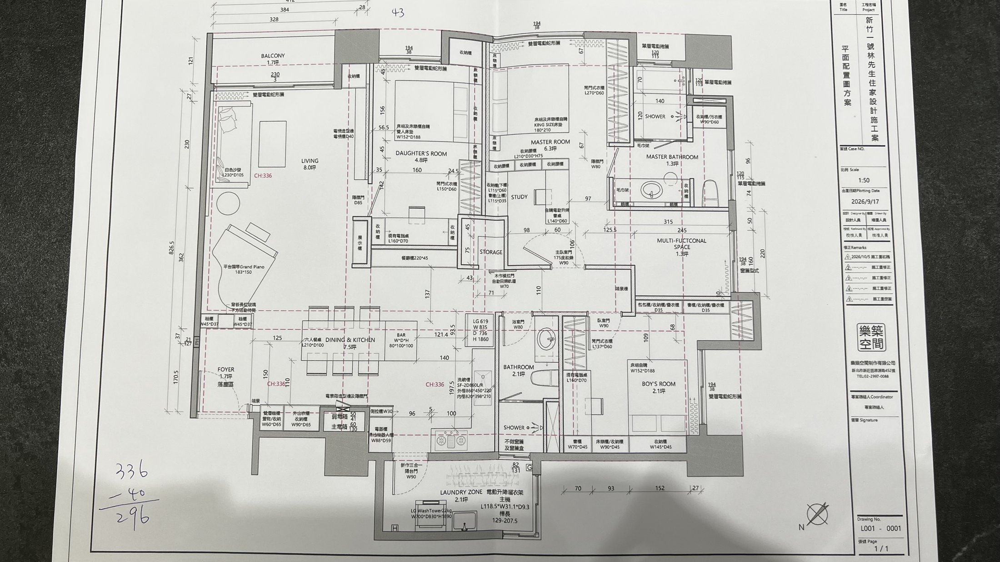

# 🏠 新竹一號・林先生住家設計施工案 — 3D 數位孿生空間導覽系統 (1:50)

🔗 **線上 3D 互動網頁 (GitHub Pages — 支援電腦、iPhone、iPad 直接瀏覽與室內行走)**：  
👉 **[https://acstep.github.io/hsinchu-house-3d/](https://acstep.github.io/hsinchu-house-3d/)**

---

## ✨ 系統核心功能

1. **🌐 3D 俯視環繞模式 (`3D Bird's-Eye & Orbit View`)**
   - 360° 自由旋轉、滾輪/雙指縮放、右鍵平移，以建築模型屋視角俯瞰全室 15 大空間分區與 1:1 家具配置。
2. **🚶 第一人稱室內行走模式 (`First-Person Walkthrough`)**
   - 以真實人眼高度（預設 `165 cm`，可於 `110 ~ 195 cm` 間自由調整）與完工樓高（`296 cm` / 原始樓高 `CH:336 cm`）在屋內自由走動。
   - **支援電腦實體鍵盤**：`W / A / S / D` 或 **`↑ / ↓ / ← / →` 方向鍵** 移動、`Q / E` 或滑鼠拖曳轉頭。
   - **支援 iPhone / iPad / 觸控螢幕**：畫面底部直接內建 **PC 方向鍵面板 (`↑` `↓` `←` `→` + `左轉/右轉/抬頭/低頭`)**，免外接鍵盤即可在手機上點按行走！
3. **📐 2D/3D 正上垂直平面對照模式 (`Top-Down Plan View`)**
   - 90° 垂直俯視，100% 對應 1:50 平面配置施工圖（圖號 `L001-0001`）。
4. **📍 15 大空間一鍵瞬移導覽與即時平面雷達 (`Mini-Map Radar`)**
   - 點擊左側導覽列或右下角小地圖雷達，即可瞬間移動至：
     - **① 玄關落塵區 (`1.7 坪`)**：雙層鞋櫃 (`W60×D65`)、外出衣櫃 (`W90×D65`)、長虹玻璃屏風與穿鞋椅凳
     - **② 客廳沙發區 (`8.0 坪`)**：白色沙發 (`L230×D105`)、大理石茶几、電視造型牆 (`D40`) 與展示櫃
     - **③ 平台鋼琴區 (`Grand Piano`)**：`183×150 cm` 平台鋼琴與圓形邊几
     - **④ 前景觀陽台 (`1.7 坪`)**：`230 cm` 落地窗與雙層電動蛇形簾
     - **⑤ 餐廳與中島吧台 (`7.5 坪`)**：六人餐桌 (`L210×D100`)、中島吧台 (`W80×D100×H100`)、餐廳櫃 (`220×45`)
     - **⑥ 開放式廚房**：IH 雙口爐、洗碗槽 (`SF-2D860`)、電器櫃與掃地機器人櫃、`LG 619` 對開冰箱
     - **⑦ 工作陽台 (`2.1 坪`)**：`LG WashTower 22kg` 洗乾衣塔、洗手台、電動升降曬衣架
     - **⑧ 女兒房 (`4.8 坪`)**：隱藏門 `D85`、雙人床 (`W152×D188`)、衣櫃 (`L150×D60`)、電腦桌 (`L160×D70`)
     - **⑨ 儲藏室 (`STORAGE`)**：木作自動回歸橫拉門 (`W70`)
     - **⑩ 主臥睡眠區 (`6.3 坪`)**：`180×210 cm` King Size 雙人床、大衣櫃 (`L270×D60`)、收納矮櫃隔屏 (`L210×D30×H75`)
     - **⑪ 主臥書房區 (`STUDY`)**：電動升降書桌 (`L140×D60`)、書櫃與收納下櫃 (`L115×D60`)
     - **⑫ 主臥衛浴 (`1.3 坪`)**：獨立浴缸 (`140×70`)、乾濕分離淋浴間 (`140×120`)、洗手台鏡櫃、污衣櫃 (`W90×D60`)
     - **⑬ 多功能室 (`1.5 坪`)**：整排收納/包包/書櫃 (`D35`) 與採光大窗
     - **⑭ 公共衛浴 (`2.1 坪`)**：乾濕分離淋浴、洗手台與馬桶
     - **⑮ 男孩房 (`2.1 坪`)**：雙人床 (`W152×D188`)、衣櫃 (`L137×D60`)、電腦桌 (`L160×D70`)、整排書櫃與收納櫃

---

## 📐 原始 1:50 平面配置設計圖對照

